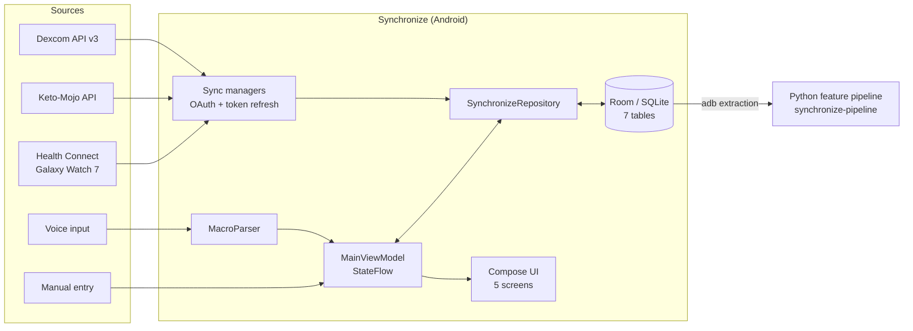

# Synchronize

**A multimodal data-collection platform for N-of-1 wearable biosignal research.**

Synchronize is an Android application that ingests continuous glucose, capillary blood ketone, smartwatch biosignal, sleep, dietary, and behavioral data into a single timestamped local database. It was built as the data-collection instrument for an MS Computer Science thesis at California State University Channel Islands:

> *Predicting Blood Ketone Levels from Consumer Wearable Biosignals: A Feature Ablation Study* (2026)

The research question is whether a consumer smartwatch, alone or combined with a continuous glucose monitor, can stand in for direct capillary ketone measurement. Answering it required a month of aligned, multi-device data that no single vendor app could produce, so this app was built to collect it.


-3DDC84)


<!-- Screenshots: add PNGs to docs/screenshots/ and uncomment.
| Dashboard | Ketones | Meals | Data |
|---|---|---|---|
|  |  |  |  |
-->

---

## Versions

| Tag / branch | What it is |
|---|---|
| [`v1.0-collection`](../../tree/v1.0-collection) | The exact build that collected the thesis dataset (30-day protocol, summer 2026). Cite this version when referring to the study apparatus. |
| `master` | The collection build plus post-study ingestion work: Dexcom refresh-token rotation, Keto-Mojo cloud API sync with glucose pairing, credentials moved to build configuration, and UI consistency fixes. The database schema is identical to `v1.0-collection`. |

---

## Data streams

| Stream | Device | Ingestion | Resolution |
|---|---|---|---|
| Interstitial glucose | Dexcom G7 CGM | Dexcom API v3 (OAuth 2.0, Individual Access) | 5-minute estimated glucose values with trend |
| Blood β-hydroxybutyrate + paired glucose | Keto-Mojo GK+ | Keto-Mojo cloud API (OAuth 2.0) or manual entry | 5 scheduled reading contexts per day |
| Heart rate, HRV (RMSSD), SpO₂, skin temperature, blood pressure, steps | Samsung Galaxy Watch 7 | Android Health Connect | Per-record, as written by Samsung Health |
| Sleep sessions and stages | Samsung Galaxy Watch 7 | Android Health Connect | Per night |
| Meals (calories, fat, protein, net carbs, fiber) | — | Voice logging via Android `SpeechRecognizer` with a custom macro parser | Per meal |
| Exercise sessions | — | Manual entry (HIIT, core/stretch, rest, other) | Per session |
| Daily covariates (caffeine, AM/PM meditation) | — | Manual entry | Per day |

Every record carries two timestamps: `deviceTimestamp` (when the device says the measurement happened) and `receiveTimestamp` (when the app ingested it). Cloud APIs deliver data late and in batches, so separating the two is what makes cross-device alignment and latency auditing possible downstream.

---

## Architecture



- **Pattern:** MVVM. Compose screens observe `StateFlow`s exposed by a single `MainViewModel`, which talks to a repository over Room DAOs.
- **Concurrency:** Kotlin coroutines for all network and database I/O.
- **Networking:** Retrofit + OkHttp for both vendor APIs; AppAuth for the OAuth authorization flow.
- **Screens:** Dashboard (device connections, daily logging), Ketones, Meals, Data (protocol progress), Settings.

### Data model

| Table | Contents |
|---|---|
| `glucose_readings` | CGM value (mg/dL), trend arrow, trend rate, transmitter ID |
| `ketone_readings` | BHB (mmol/L), paired fingerstick glucose, reading context, source (`MOJO_API` or manual) |
| `biosignal_samples` | Heart rate, HRV, SpO₂, skin temperature, blood pressure, steps, active calories |
| `sleep_sessions` | Start/end, stage durations and percentages, overnight HRV and heart rate |
| `meal_entries` | Macros, derived total carbs and ketogenic ratio, raw transcription, meal label |
| `exercise_sessions` | Start time, duration, session type, derived HIIT flag |
| `daily_covariates` | One row per day: caffeine (mg), AM and PM meditation minutes |

---

## Engineering notes

Problems that came up while running a real month-long collection, and how the app handles them:

- **Rotating refresh tokens.** Dexcom issues a new refresh token on every refresh and invalidates the old one. The app persists each new token immediately; failing to do so silently breaks the next sync, typically overnight.
- **Out-of-range sentinels.** The Keto-Mojo CSV export encodes a below-range "LO" reading as a numeric `0.00` with no error flag, so it is indistinguishable from a real value. The API reports these as errors, and the sync skips them rather than storing a false zero.
- **Ketone–glucose pairing.** The GK+ meter measures ketones and glucose on separate strips. The sync pairs each ketone reading with the nearest glucose reading within ±5 minutes.
- **Idempotent sync.** API readings are inserted only if no reading with the same device timestamp exists, so repeated syncs don't duplicate data.
- **Voice logging.** `MacroParser` accepts free-form speech such as *"350 calories, 28 fat, 22 protein, 4 net carbs, 12 fiber"*, normalizes spoken numbers, and derives total carbs and the ketogenic ratio. Each entry is confirmed on screen before it is saved.
- **Protocol reminders.** `AlarmManager` notifications fire at the five scheduled reading times (07:30, 11:30, 13:30, 17:30, 21:30), one per reading context.
- **Consistent backups.** The in-app backup checkpoints the SQLite write-ahead log before copying, so the backup is a single self-contained file.
- **Secrets stay out of source.** API credentials are read from `local.properties` (gitignored) into `BuildConfig` at build time, and the build fails with a clear message if any are missing.
- **App lock.** Access is gated behind `BiometricPrompt` on devices with biometrics enrolled.

---

## Getting started

### Requirements

- Android Studio (recent stable), JDK 17
- An Android 14+ device (minSdk 34) with Health Connect
- A [Dexcom developer](https://developer.dexcom.com) application for CGM access
- Keto-Mojo API client credentials for ketone sync (manual entry works without them)
- A Samsung Galaxy Watch syncing to Samsung Health, with Samsung Health writing to Health Connect

### Setup

```bash
git clone https://github.com/danaharper151/Synchronize.git
cd Synchronize
cp local.properties.example local.properties
```

Fill in `local.properties`:

```properties
DEXCOM_CLIENT_ID=...
DEXCOM_CLIENT_SECRET=...
MOJO_CLIENT_ID=...
MOJO_CLIENT_SECRET=...
DB_PASSPHRASE=...   # reserved; see Limitations
```

Then open the project in Android Studio and run it on a device. On first launch:

1. **Dexcom:** tap *Connect Dexcom G7* and sign in. Both OAuth flows redirect through a small GitHub Pages relay (`danaharper151.github.io/synchronize-oauth`), which hands the authorization code back to the app. If you fork the project, register your own redirect URIs and update `Constants.kt`.
2. **Keto-Mojo:** tap *Connect Keto-Mojo GK+* and sign in.
3. **Galaxy Watch:** tap *Grant Access* on the watch card and allow all requested Health Connect permissions.
4. **Reminders:** turn on reading reminders in Settings.

### Extracting the data

The database lives in app-private storage. On a debug build it can be pulled with `run-as`:

```bash
adb exec-out run-as com.synchronize.app cat databases/synchronize_db     > synchronize_db
adb exec-out run-as com.synchronize.app cat databases/synchronize_db-wal > synchronize_db-wal
```

> **Windows:** run these through `cmd /c "..."`. PowerShell's `>` re-encodes output as UTF-16 and corrupts binary files.

---

## Analysis

The companion repository **synchronize-pipeline** turns the extracted database and vendor exports into model-ready features:

- Multi-resolution windows (30, 60 and 120 minutes, plus an overnight sleep vector) anchored to each ketone reading
- A four-model feature ablation (A–D) varying which sensor streams are available
- Random Forest and XGBoost regressors, evaluated with leave-one-day-out cross-validation (primary, 30 folds) and LOOCV

In the study, CGM-derived features carried the predictive signal, and the smartwatch-only model did not hold up under leave-one-day-out validation. Full results and methodology are in the thesis.

---

## Limitations

These are stated plainly so anyone reusing the platform knows what they are getting:

- **Single subject.** The app was built for one participant; the subject ID (`subject_001`), reading contexts, and reminder times are compile-time constants. A configurable version is in progress on the `configurable-wip` branch.
- **Database is not encrypted.** The SQLCipher dependency and passphrase plumbing are present, but the Room database is not yet opened through SQLCipher.
- **Manual and API ketone readings can duplicate.** The sync's duplicate check matches exact device timestamps, so a reading entered by hand and later synced from the API is stored twice. These are removed in the analysis pipeline.
- **Health Connect resolution.** Watch data arrives at whatever granularity Samsung Health writes to Health Connect. Several `biosignal_samples` columns (ECG, raw PPG, stress score) are reserved and are not populated through Health Connect.
- **Live dashboard disabled.** A WebSocket server for streaming data to a desktop dashboard exists in source but is commented out.
- **Minimal automated tests.**

---

## Disclaimer

Synchronize is a research tool. It is not a medical device, it does not provide diagnoses or treatment recommendations, and its color thresholds are for display only.

---

## Citation

If you use this software, please cite the thesis and the collection version:

```
Harper, D. (2026). Predicting Blood Ketone Levels from Consumer Wearable
Biosignals: A Feature Ablation Study [Master's thesis, California State
University Channel Islands]. Software: https://github.com/danaharper151/Synchronize
(tag v1.0-collection).
```

## Author

**Dana Harper** — MS Computer Science, California State University Channel Islands.
Thesis advisor: Dr. Thoms.

## License

[MIT](LICENSE)
